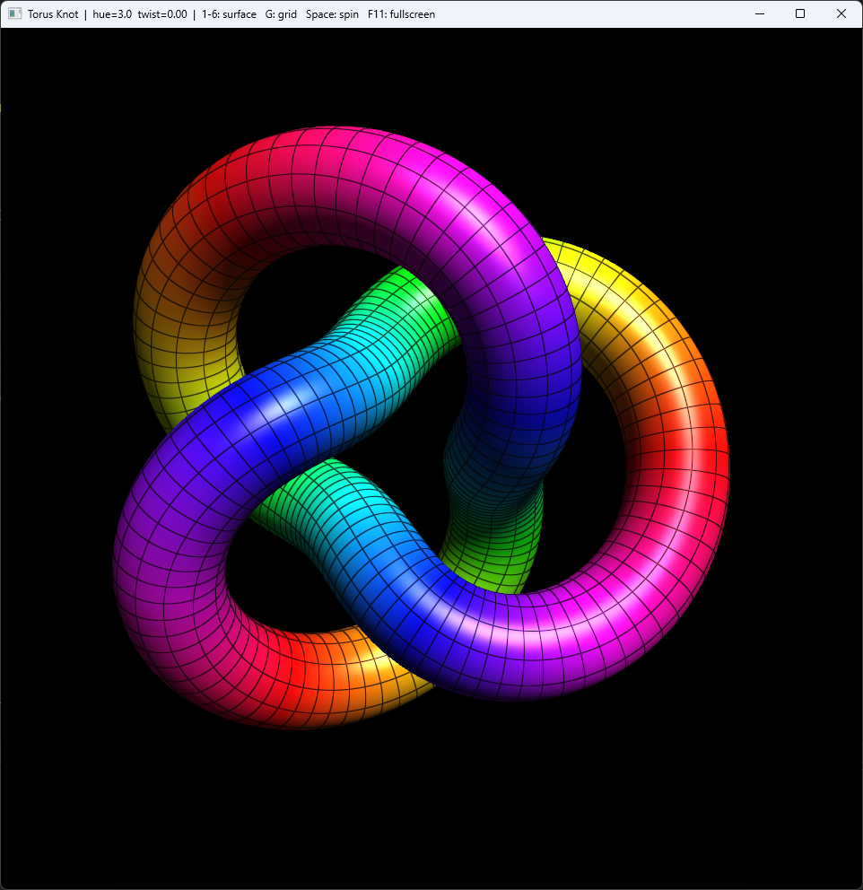

# Surfaces
[](https://github.com/sponsors/makarov-mm)
[](https://en.cppreference.com/w/cpp/26)
[](LICENSE)

Six parametric surfaces in one window, rendered with rainbow HSV shading, a live
wireframe overlay, and Blinn-Phong specular. C++ and OpenGL 3.3. The point is the
look, not mathematical depth: switch surfaces, spin them, tweak the colours.



## Surfaces

| key | surface      | what it is                                                        |
|-----|--------------|-------------------------------------------------------------------|
| 1   | Torus Knot   | (p,q) knot swept as a tube along a rotation-minimizing frame       |
| 2   | Seashell     | logarithmic snail shell                                            |
| 3   | Klein Bottle | figure-8 immersion                                                |
| 4   | Dini         | twisted pseudosphere                                              |
| 5   | Breather     | pseudospherical breather surface                                  |
| 6   | Kuen         | Kuen surface                                                       |

## Rendering

- Per-fragment Blinn-Phong with a view-space headlight, so highlights track the camera.
- Hue comes from one surface parameter, converted HSV to RGB in the shader. A twist
  term shears the hue across the other parameter to get diagonal colour bands.
- The wireframe is computed from UV coordinates in the fragment shader, anti-aliased
  with `fwidth`, so line density is independent of tessellation.
- 4x MSAA. Every surface is auto-centered and scaled to the same view box.
- Normals: analytic (radial) for the knot tube, finite differences of the
  parametric map for the rest.

Adding a surface is one `evalX(u, v)` function in `src/surfaces.h` plus an entry in
the enum, `surfaceInfo()`, `evalParam()`, and one key case in `src/main_win32.cpp`.

The math layer (`src/math3d.h` and the surface eval in `src/surfaces.h`) is
`constexpr` and `[[nodiscard]]` throughout, with compile-time `static_assert`
checks on the algebraic primitives. It builds as C++26 (`/std:c++latest`); the
`<cmath>`-based helpers stay `constexpr` via relaxed constexpr (P2448) and become
constant-evaluable once the toolchain ships constexpr `<cmath>` (P1383), with no
source change.

## Build

Open `Surfaces.slnx` in Visual Studio, pick `Release | x64`, build and run. Links
only the system `opengl32` / `gdi32` / `user32`. The window and GL 3.3 core context
are created directly with Win32 + WGL (`src/main_win32.cpp`); the GL loader (glad)
is vendored under `extern/glad`, so there is nothing to install, no vcpkg and no
NuGet.

Built as C++26 (`/std:c++latest`) with the `v145` toolset (Visual Studio 2026).
On an older Visual Studio, retarget the platform toolset when prompted; the code
itself only relies on library features available up to C++23 (`std::format`,
`std::span`, `std::numbers`, relaxed constexpr), so `/std:c++latest` on VS 2022
17.x works too.

## Controls

| input         | action                                             |
|---------------|----------------------------------------------------|
| 1 - 6         | switch surface                                     |
| mouse drag    | rotate                                             |
| scroll        | zoom                                               |
| Space         | toggle auto-rotate                                 |
| G             | toggle wireframe                                    |
| `[` `]`       | colour twist                                       |
| `-` `=`       | colour band count                                  |
| arrows        | torus knot p and q                                 |
| `;` `'`       | torus knot tube radius                             |
| R             | reset                                              |
| F11 / Esc     | fullscreen / quit                                  |

## Layout

```
Surfaces.slnx / Surfaces.vcxproj   Visual Studio project (Win32 + WGL)
src/main_win32.cpp                 Win32 + WGL platform layer
src/surfaces.h                     surface eval + mesh generation (no GL)
src/math3d.h                       small constexpr vec3 / mat4 (no dependencies)
extern/glad/                       vendored OpenGL 3.3 core loader
```

## License

MIT License

Copyright (c) 2026 Mykhailo Makarov

Permission is hereby granted, free of charge, to any person obtaining a copy
of this software and associated documentation files (the "Software"), to deal
in the Software without restriction, including without limitation the rights
to use, copy, modify, merge, publish, distribute, sublicense, and/or sell
copies of the Software, and to permit persons to whom the Software is
furnished to do so, subject to the following conditions:

The above copyright notice and this permission notice shall be included in all
copies or substantial portions of the Software.

THE SOFTWARE IS PROVIDED "AS IS", WITHOUT WARRANTY OF ANY KIND, EXPRESS OR
IMPLIED, INCLUDING BUT NOT LIMITED TO THE WARRANTIES OF MERCHANTABILITY,
FITNESS FOR A PARTICULAR PURPOSE AND NONINFRINGEMENT. IN NO EVENT SHALL THE
AUTHORS OR COPYRIGHT HOLDERS BE LIABLE FOR ANY CLAIM, DAMAGES OR OTHER
LIABILITY, WHETHER IN AN ACTION OF CONTRACT, TORT OR OTHERWISE, ARISING FROM,
OUT OF OR IN CONNECTION WITH THE SOFTWARE OR THE USE OR OTHER DEALINGS IN THE
SOFTWARE.

## Support

If you found this project interesting or useful, you can support my work:

[](https://github.com/sponsors/makarov-mm)
